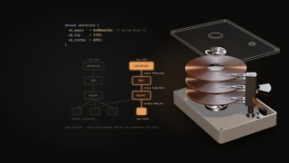
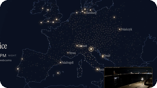

<picture>
  <source media="(prefers-color-scheme: dark)" srcset="assets/hero-dark.svg">
  
</picture>

  
  
  
  

More ideas than nights. I invent things for the pleasure of seeing them run: a firmware for a forgotten watch, apps for the living-room TV,
a kernel on a board nobody ported it to. To keep up with the ideas, I gave them an organization of AI agents: **[ALGOTITAN](https://github.com/algotitanhq)**.

 

<picture>
  <source media="(prefers-color-scheme: dark)" srcset="assets/section-repos-dark.svg">
  
</picture>

<!-- repos:start -->
| Project | What it is | Stack & topics |
|---|---|---|
|   **[Uberblok](https://github.com/algotitanhq/uberblok)** <picture><source media="(prefers-color-scheme: dark)" srcset="assets/status-uberblok-dark.svg"></picture>  | An interactive museum of ZFS, visited room by room: copy-on-write, transaction groups, RAID-Z, the ARC, the ZIL. Every animation is read from the OpenZFS source. [Visit it](https://uberblok.storagebits.workers.dev). |      <code>filesystem</code> <code>openzfs</code> <code>storage</code> <code>zfs</code> |
|   **[Lukarne](https://github.com/storagebits/lukarne)** <picture><source media="(prefers-color-scheme: dark)" srcset="assets/status-lukarne-dark.svg"></picture>  | A window onto the world for Android TV: spin a night-and-day globe with the remote, dive into a region, zap through walls of live webcams. MIT, an APK to sideload. [The project page](https://blok.storagebits.workers.dev/projects/lukarne/). |     <code>android-tv</code> <code>day-night</code> <code>globe</code> <code>kotlin</code> <code>nvidia-shield</code> <code>webcams</code> |
|   **[Kronograf](https://github.com/storagebits/kronograf)** <picture><source media="(prefers-color-scheme: dark)" srcset="assets/status-kronograf-dark.svg"></picture>  | A from-scratch firmware for the LilyGO T-Watch 2020: aviator chronograph, *Back to the Future* time circuits, iPhone notifications over BLE, live buses, a network toolbox, and a macOS simulator. |       <code>ancs</code> <code>ble</code> <code>esp32</code> <code>firmware</code> <code>gtfs-realtime</code> <code>lilygo</code> |
|   **[Almanak](https://github.com/algotitanhq/almanak)** <picture><source media="(prefers-color-scheme: dark)" srcset="assets/status-almanak-dark.svg"></picture>  | An ambient almanac for Android TV, made to be left on: time, weather, the next bus in real time, sun and moon, a generative sky. Open data, no account. |     <code>android-tv</code> <code>compose-for-tv</code> <code>kotlin</code> <code>open-data</code> <code>screensaver</code> |
|   **[Humility](https://github.com/storagebits/humility)** <picture><source media="(prefers-color-scheme: dark)" srcset="assets/status-humility-dark.svg"></picture>  | Fork of Oxide's Hubris debugger, used to bring Hubris up on a NUCLEO-F412ZG, a board it does not support. [The write-up](https://blok.storagebits.workers.dev/blog/hubris-f412/). |    |
|   **[KISSS](https://github.com/storagebits/KISSS)** <picture><source media="(prefers-color-scheme: dark)" srcset="assets/status-kisss-dark.svg"></picture>  | *Keep It Simple Slide Scanner*: a DIY rig to digitise old film slides. |      <code>nextcloud</code> <code>opencv-python</code> <code>photography</code> <code>raspberry</code> <code>relay-switch</code> <code>scanning</code> |
|  **[babeltro](https://github.com/algotitanhq/babeltro)** <picture><source media="(prefers-color-scheme: dark)" srcset="assets/status-babeltro-dark.svg"></picture>  | Nine classic demoscene effects in thirteen languages, from C and Rust to SQL, Perl and x86 assembly, running live in your browser and drawing exactly the same pixels. |   <code>creative-coding</code> <code>demoscene</code> <code>webassembly</code> |
<!-- repos:end -->

<b>Earlier work</b>

 

| Project | What it was |
|---|---|
| [nasa-meteor-to-planetaryjs](https://github.com/storagebits/nasa-meteor-to-planetaryjs) | NASA Space Apps hackathon: meteorite falls on a 3D globe, with an international team of six. |
| [vectests](https://github.com/storagebits/vectests) | Programming the Vectrex, a 1982 vector-display console. |
| [board-explorer](https://github.com/storagebits/board-explorer) | Electronics meets board games, in Go. |
| [terraform-oci-free-compute](https://github.com/storagebits/terraform-oci-free-compute-maximal-example) | Getting the most out of Oracle Cloud's free tier with Terraform. |

 

<picture>
  <source media="(prefers-color-scheme: dark)" srcset="assets/section-stack-dark.svg">
  
</picture>

<picture>
  <source media="(prefers-color-scheme: dark)" srcset="assets/stack-dark.svg">
  
</picture>

 

<picture>
  <source media="(prefers-color-scheme: dark)" srcset="assets/section-lately-dark.svg">
  
</picture>

<!-- activity:start -->
- [`algotitanhq/babeltro`](https://github.com/algotitanhq/babeltro) · [X86 assembly: the finale, so every language now does all nine effects](https://github.com/algotitanhq/babeltro/commit/c8f0bb94a424fdd9d6cd475883c21d7cf29e090b) today
- [`storagebits/lukarne-catalog`](https://github.com/storagebits/lukarne-catalog) · [Catalogue 2026-10-28T10:40Z](https://github.com/storagebits/lukarne-catalog/commit/2199d5450512bc9e198b7cc4629583ea8600562b) today
- [`algotitanhq/.github`](https://github.com/algotitanhq/.github) · [Profile: Kronograf row reworded, beta v0.7.0](https://github.com/algotitanhq/.github/commit/cd7dc26efd9e98c325ecb16a345c475c2e529e30) today
- [`algotitanhq/uberblok`](https://github.com/algotitanhq/uberblok) · [Merge ALG-199: v1.4 ZIL room, question first (ALG-200, PR #17)](https://github.com/algotitanhq/uberblok/commit/fce3786806612b0ff11e959208d7a1a0b2e02969) 4 days ago
- [`algotitanhq/almanak`](https://github.com/algotitanhq/almanak) · [Merge ALG-221: fix/alg-221-event-text into main](https://github.com/algotitanhq/almanak/commit/8def4745ac7acb6dbe83887c4af1ff5ba961c34a) 3 days ago
<!-- activity:end -->

**Writing.** The stories behind the code are on [blok](https://blok.storagebits.workers.dev), in French, English and Spanish:

<!-- posts:start -->
- **[A Redmi 9A and a Galaxy Tab 2 debloated with Claude: the numbers before and after](https://blok.storagebits.workers.dev/blog/seconde-vie/)** Oct 26, 2026 A weekend spent slimming down a budget phone and a 2012 tablet with Claude Code: what the measurements say, and what the agent broke on its own…
- **[A comment on Hacker News, in production four hours later](https://blok.storagebits.workers.dev/blog/boucle-hn/)** Oct 22, 2026 On October 22, a stranger's suggestion on Hacker News reached production on Uberblok in 4 h 05. I said "go" and approved the merge. Agents did the…
<!-- posts:end -->

 

<picture>
  <source media="(prefers-color-scheme: dark)" srcset="assets/footer-dark.svg">
  
</picture>
