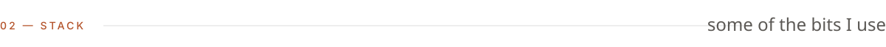
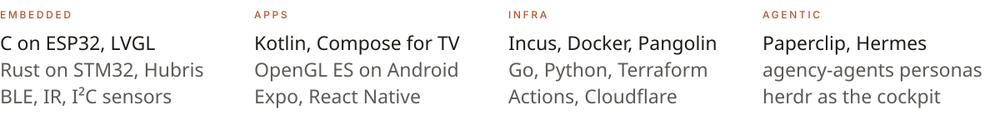

<picture>
  <source media="(prefers-color-scheme: dark)" srcset="assets/hero-dark.svg">
  
</picture>

  
  
  
  

More ideas than nights. I invent things for the pleasure of seeing them run: a firmware for a forgotten watch, apps for the living-room TV,
a kernel on a board nobody ported it to. To keep up with the ideas, I gave them a company of AI agents: **[ALGOTITAN](https://github.com/algotitanhq)**.

 

<picture>
  <source media="(prefers-color-scheme: dark)" srcset="assets/section-repos-dark.svg">
  
</picture>

| Project | What it is | Status |
|---|---|:---:|
| **[Kronograf](https://github.com/storagebits/kronograf)** ESP32 · C · LVGL | A from-scratch firmware for the LilyGO T-Watch 2020: aviator chronograph, *Back to the Future* time circuits, iPhone notifications over BLE, live buses, a network toolbox, and a macOS simulator. | <picture><source media="(prefers-color-scheme: dark)" srcset="assets/status-kronograf-dark.svg"></picture> |
| **[Almanak](https://github.com/algotitanhq/almanak)** Android TV · Kotlin · Compose | An ambient almanac for Android TV, made to be left on: time, weather, the next bus in real time, sun and moon, a generative sky. Open data, no account. | <picture><source media="(prefers-color-scheme: dark)" srcset="assets/status-almanak-dark.svg"></picture> |
| **[Humility](https://github.com/storagebits/humility)** Rust · STM32 | Fork of Oxide's Hubris debugger, used to bring Hubris up on a NUCLEO-F412ZG, a board it does not support. [The write-up](https://blok.storagebits.workers.dev/blog/hubris-f412/). | <picture><source media="(prefers-color-scheme: dark)" srcset="assets/status-humility-dark.svg"></picture> |
| **[lukarne-catalog](https://github.com/storagebits/lukarne-catalog)** Data · daily job | The live-webcam catalogue behind Lukarne, an Android TV globe of webcams (the app is still on the bench). Regenerated every day. | <picture><source media="(prefers-color-scheme: dark)" srcset="assets/status-lukarne-catalog-dark.svg"></picture> |
| **[KISSS](https://github.com/storagebits/KISSS)** Python · Shell | *Keep It Simple Slide Scanner*: a DIY rig to digitise old film slides. | <picture><source media="(prefers-color-scheme: dark)" srcset="assets/status-kisss-dark.svg"></picture> |

<b>Earlier work</b>

 

| Project | What it was |
|---|---|
| [nasa-meteor-to-planetaryjs](https://github.com/storagebits/nasa-meteor-to-planetaryjs) | NASA Space Apps hackathon: meteorite falls on a 3D globe, with an international team of six. |
| [vectests](https://github.com/storagebits/vectests) | Programming the Vectrex, a 1982 vector-display console. |
| [board-explorer](https://github.com/storagebits/board-explorer) | Electronics meets board games, in Go. |
| [terraform-oci-free-compute](https://github.com/storagebits/terraform-oci-free-compute-maximal-example) | Getting the most out of Oracle Cloud's free tier with Terraform. |

 

<picture>
  <source media="(prefers-color-scheme: dark)" srcset="assets/section-stack-dark.svg">
  
</picture>

<picture>
  <source media="(prefers-color-scheme: dark)" srcset="assets/stack-dark.svg">
  
</picture>

 

<picture>
  <source media="(prefers-color-scheme: dark)" srcset="assets/section-lately-dark.svg">
  
</picture>

<!-- activity:start -->
- [`algotitanhq/almanak`](https://github.com/algotitanhq/almanak) · [Initial public import of Almanak](https://github.com/algotitanhq/almanak/commit/77c5d35687add036a5a34aea9dfc3a780f1e761d) today
- [`storagebits/kronograf`](https://github.com/storagebits/kronograf) · [Toolbox: keep Wi-Fi modem sleep while Bluetooth is on (fixes reboots…](https://github.com/storagebits/kronograf/commit/3e82b01be65432e8db7f3a5c7230f1a6d87da451) 4 days ago
<!-- activity:end -->

**Writing.** The stories behind the code are on [blok](https://blok.storagebits.workers.dev), in French, English and Spanish:

<!-- posts:start -->
- **[Testing the NUCLEO-F412ZG with Hubris and Humility](https://blok.storagebits.workers.dev/blog/hubris-f412/)** Oct 18, 2026 Porting Hubris, Oxide Computer's embedded OS, to a NUCLEO-F412ZG at 100 MHz: what had to change, from the untouched kernel to the two Humility…
- **[A 2020 watch, a complete firmware, three days](https://blok.storagebits.workers.dev/blog/ressusciter-kronograf/)** Oct 16, 2026 A 2020 T-Watch was sitting in a corner: developing for it took too much effort. In three days, with an agent, it got a firmware written from…
<!-- posts:end -->

 

<picture>
  <source media="(prefers-color-scheme: dark)" srcset="assets/footer-dark.svg">
  
</picture>
