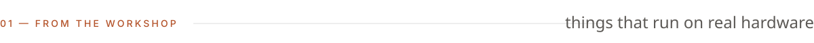
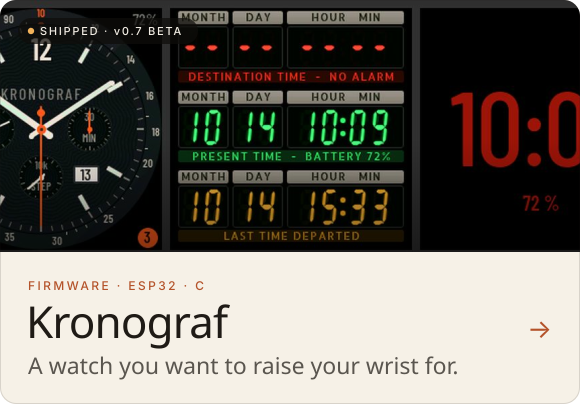
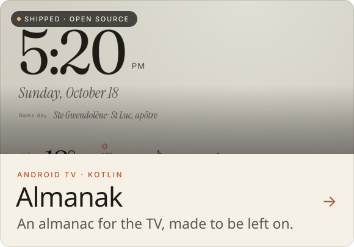
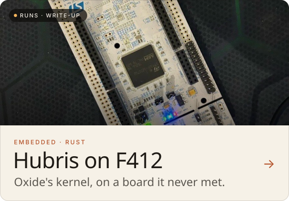
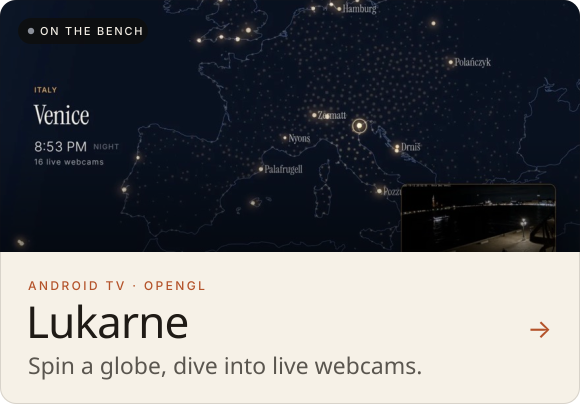
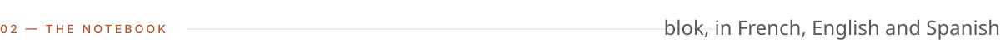
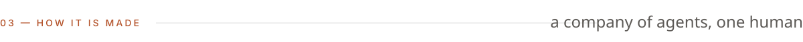
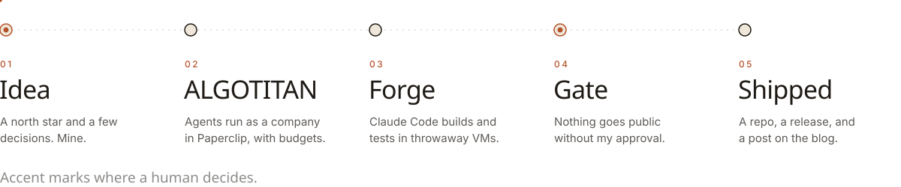

<picture>
  <source media="(prefers-color-scheme: dark)" srcset="assets/hero-dark.svg">
  
</picture>

  
  
  

I make things I want to use myself: a firmware for a 2020 smartwatch, apps for the TV in the living room,
an embedded kernel on a board it was never ported to, a homelab that rebuilds from its own docs.
Since October 2026 the agents that build them are organised as a company, **[ALGOTITAN](https://github.com/algotitanhq)**.

> [!NOTE]
> Everything here is built with AI agents, and each project says so. I set the direction, test on the real device and approve what ships; the agents write most of the code and the first drafts.

 

<picture>
  <source media="(prefers-color-scheme: dark)" srcset="assets/section-work-dark.svg">
  
</picture>

<a href="https://github.com/storagebits/kronograf"><picture><source media="(prefers-color-scheme: dark)" srcset="assets/card-kronograf-dark.svg"></picture></a> <a href="https://github.com/algotitanhq/almanak"><picture><source media="(prefers-color-scheme: dark)" srcset="assets/card-almanak-dark.svg"></picture></a>
<a href="https://blok.storagebits.workers.dev/blog/hubris-f412/"><picture><source media="(prefers-color-scheme: dark)" srcset="assets/card-hubris-dark.svg"></picture></a> <a href="https://blok.storagebits.workers.dev/blog/quatre-jours/"><picture><source media="(prefers-color-scheme: dark)" srcset="assets/card-lukarne-dark.svg"></picture></a>

<b>See them run</b>

 

  
  

Also on the bench: **DropboksTV** (the family Dropbox on the TV, signed in with a QR code) and **Shot2Cart** (from a photo to an open shopping cart in under 15 seconds). They come out when they are finished.

 

<picture>
  <source media="(prefers-color-scheme: dark)" srcset="assets/section-notebook-dark.svg">
  
</picture>

[blok](https://blok.storagebits.workers.dev) is the workshop notebook: what works, what breaks, and what building with an AI changes. Each post lists its sources and how much of the draft I rewrote.

<!-- posts:start -->
- **[Testing the NUCLEO-F412ZG with Hubris and Humility](https://blok.storagebits.workers.dev/blog/hubris-f412/)** Oct 18, 2026 Porting Hubris, Oxide Computer's embedded OS, to a NUCLEO-F412ZG at 100 MHz: what had to change, from the untouched kernel to the two Humility…
- **[A 2020 watch, a complete firmware, three days](https://blok.storagebits.workers.dev/blog/ressusciter-kronograf/)** Oct 16, 2026 A 2020 T-Watch was sitting in a corner: developing for it took too much effort. In three days, with an agent, it got a firmware written from…
- **[Twelve minutes from idea to TV](https://blok.storagebits.workers.dev/blog/quatre-jours/)** Oct 12, 2026 Four days, six projects, 159 commits. The gap between “I'd like that” and “it runs on the device” has become ridiculous. What still slows things…
<!-- posts:end -->

 

<picture>
  <source media="(prefers-color-scheme: dark)" srcset="assets/section-made-dark.svg">
  
</picture>

<picture>
  <source media="(prefers-color-scheme: dark)" srcset="assets/workshop-dark.svg">
  
</picture>

Underneath: a homelab on Incus where every service sits behind an authenticated tunnel, is backed up and monitored, and can be rebuilt from its documentation. Twenty years of infrastructure leave one rule: sober, coherent, reproducible.

<b>Earlier work</b>

 

| | |
|---|---|
| [KISSS](https://github.com/storagebits/KISSS) | *Keep It Simple Slide Scanner*: a DIY rig to digitise old film slides. |
| [nasa-meteor-to-planetaryjs](https://github.com/storagebits/nasa-meteor-to-planetaryjs) | NASA Space Apps hackathon: meteorite falls on a 3D globe, with an international team of six. |
| [vectests](https://github.com/storagebits/vectests) | Programming the Vectrex, a 1982 vector-display console. |
| [board-explorer](https://github.com/storagebits/board-explorer) | Electronics meets board games, in Go. |
| [terraform-oci-free-compute](https://github.com/storagebits/terraform-oci-free-compute-maximal-example) | Getting the most out of Oracle Cloud's free tier with Terraform. |

 

<picture>
  <source media="(prefers-color-scheme: dark)" srcset="assets/footer-dark.svg">
  
</picture>
